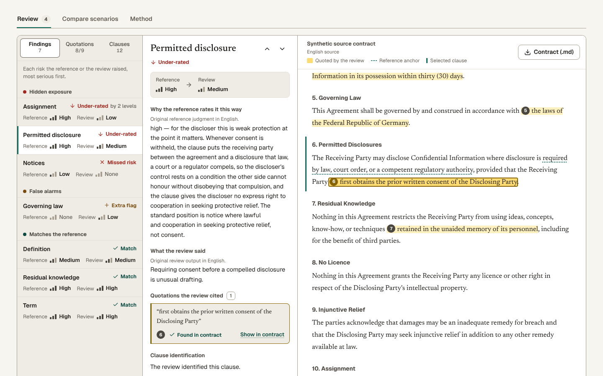

# Contract Review Evidence Lab — Interactive Web Explorer

A browser evaluation workspace for the synthetic NDA, SaaS and DPA cases in Sebastian Förste's [contract-review-eval-harness](https://github.com/sebastianfoerste/contract-review-eval-harness).

This application is the interactive explorer for the Contract Review Evaluation project. The authoritative Python engine owns evaluation methodology, reference answers, scoring and release evidence. The web app makes fixed results, failure scenarios and source quotations inspectable. It uses Next.js App Router conventions through vinext on Vite and builds as a Cloudflare Worker.



*Local screenshot, not a hosted page: the production build served by `npm start` at `http://127.0.0.1:8787`, captured with Playwright in a 1440 × 900 viewport after **Inspect this finding**, scrolled down to the review sheet, so the page header and result summary above it are not shown (synthetic mutual NDA, original fixture scenario).*

## Run it locally

There is no hosted demo. The app runs on your own machine and needs Node 22.13 or later:

```bash
npm run install:ci
npm run dev
```

Then open `http://localhost:5173`. To serve the production build instead, run `npm run build` and then `npm start`, which serves it at `http://127.0.0.1:8787`.

## Features

- Start with an existing fixture error: the synthetic NDA's permitted-disclosure clause is rated high in the reference and medium in the fixed review. Open that finding and its exact quotation, or move directly into exploration.
- Choose a contract and failure scenario. Each choice is re-scored by the bounded server API; the first view is a deterministic reference snapshot. A failed request keeps the previous result and offers a retry.
- Read a compact result summary first, then expand metric definitions and detailed scores.
- Work in a three-column desktop review sheet. On phones, use the finding, explanation and contract steps; transitions move keyboard focus to the selected panel.
- Findings are grouped and ordered by seriousness. Hidden exposure (a missed, under-rated or contradictory risk) ranks above any false alarm, and ties go to the higher-severity clause.
- See every quoted passage highlighted and numbered in the contract. The selected clause carries a margin rule and its reference anchor is underlined, so a missed risk shows where the review should have looked.
- Compare all four scenarios in a sensitivity matrix, list every clause, flag and quotation that differs between two scenarios, and reopen server runs from this session.
- Share contract, scenario, selected comparison, tab, list, finding, exact quotation index, phone panel and language. Removed comparison quotations have their own `cquote` index. Reference-edition mismatches show a warning; they do not silently claim to restore an old result. Legacy findings/evidence links still work.
- Use English or German controls, explanations and reports. Original English contracts, quotations, reference rationales, identifiers and raw JSON retain their original wording and are labeled accordingly.
- Download Markdown and JSON, or open `/report` for a readable print view with a browser **Print / Save as PDF** action. The app does not generate or confirm a saved PDF. The print route reconstructs the deterministic snapshot; export JSON or Markdown from the workspace to retain a session run's original timestamp and identifier. Historical print views are blocked when the reference edition differs.
- Light and dark themes follow the system and remain switchable when local storage fails. A versioned, vendored design package supplies the shared palette and licensed local Newsreader/Geist fonts. No font CDN is required.

The app calls no live model, accepts no contract uploads and stores no shared user history. Session runs are held in memory, capped at 30 and cleared on refresh. Reports must be downloaded for retention. The evaluation API accepts only allowlisted synthetic cases and scenarios, with a 1 KiB input limit.

## Reference status

This release scores reviews against the v1 reference answers from the Python repository. At the recorded harness commit, the exported evidence gate for the v2 candidate answers stands at `awaiting_returns`: independent returns, written adjudication and a verified freeze are still missing. This app cannot verify or publish a v2 benchmark until those artifacts are imported and checked in the Python harness. It issues no release certificate. The Python harness version remains 0.7.0rc1.

The interface reads the exported `referenceEvidence` gate directly. The gate describes the v2 candidate answers, not the v1 answers used for scoring, and the report and Method tab label the two separately. A missing denominator appears as N/A in the interface and report; JSON results retain the Python-compatible numeric values.

## Development

Use Node 22.13 or later.

```bash
npm run install:ci
npm run dev
npm test
npm run test:types
npm run build
npm run check
```

`npm run build` writes a Cloudflare Worker to `dist/`, and `npm start` serves that build locally with Wrangler. The app is maintained separately from the Python harness. See [PROJECT_ARCHITECTURE.md](https://github.com/sebastianfoerste/contract-review-eval-harness/blob/main/docs/PROJECT_ARCHITECTURE.md) for architectural details.

The production scoring port is `lib/scoring.ts`. Regenerate inputs and expected parity scores from the harness:

```bash
npm run export:benchmark
# or with an explicit harness path:
python3 scripts/export-benchmark.py --repo /path/to/contract-review-eval-harness
```

`npm run check` also starts the built local Worker and runs the HTTP contract checks. To run the same checks against a server you started yourself, for example with `npm start`, pass its origin:

```bash
node tests/api-check.mjs http://127.0.0.1:8787
```

Every supported case and scenario is checked against Python `score_review` (30 parity vectors in `tests/scoring.test.mjs`). Additional tests cover edge cases, score presentation, alias-resolved risk findings, severity direction, the plain-language readout, clause coverage, comparison changes, contract rendering offsets, source offsets after characters outside the Basic Multilingual Plane, the evidence report, shareable URL parsing and the reference gate. `tests/export.test.mjs` recomputes the export's integrity and source hashes and checks that its schema, scoring edition and release match this app, so a hand-edited `lib/benchmark.json` fails `npm test`. The HTTP suite checks 12 supported case-scenario combinations and five invalid requests. These checks cover the bounded API inputs; they do not establish general equivalence for arbitrary documents or Unicode inputs.

## Incorporating adjudicated evidence

1. Import all three original independent return files and the written adjudication records into the Python repository.
2. Validate the return hashes and source offsets, resolve every disagreement, and freeze the v2 gold sets through the repository's workflow.
3. Regenerate and verify the evidence-bound campaign and certificates there.
4. Extend this app's versioned input export and scoring parity coverage to the v2 scorer before displaying v2 validation status.

Never replace missing annotation evidence with generated answers or remove the Python release hold based on this web app.

An [independent challenge-set protocol](docs/challenge-set-protocol.md) records the acceptance criteria for a future blinded evaluation. No unseen, independently adjudicated challenge set is claimed in this release.

## Validation limits

The 2026-10-10 local browser check covered guided entry, DE/EN switching, keyboard finding navigation, a 390 CSS-pixel phone view, exact own/comparison quotation restoration, theme cycling, server scenario selection, reference-edition warnings and EN/DE print views. Print CSS was inspected; no saved PDF or deployment is claimed. Core text and status color pairs were checked at 4.5:1 or better in both themes. This is not a full screen-reader, browser-matrix or WCAG conformance audit.

Tests cover denied-storage theme behavior, locale-invariant score identities and URL allowlists. The HTTP gate checks the report route alongside the original scoring requests. See [implementation and acceptance notes](docs/product-experience-acceptance.md) for the scope and remaining human acceptance work.

The optional WebMCP registration is feature-detected. Ordinary app functions use the visible controls and evaluation API independently of WebMCP.

## License

MIT. Python-derived scoring and synthetic reference inputs copyright 2026 Sebastian Förste. See LICENSE.
